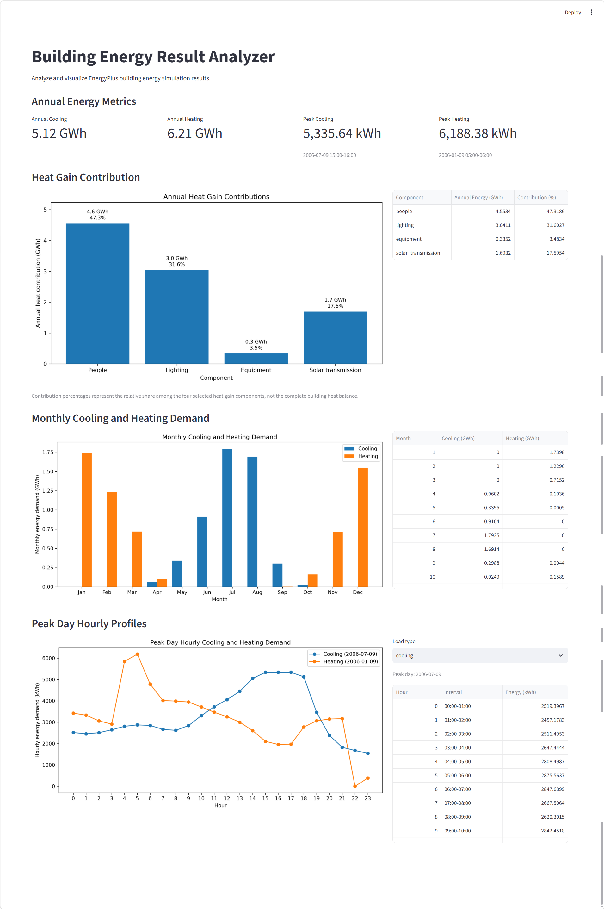

# Building Energy Result Analyzer

A Python-based toolkit for processing, comparing, visualizing, and reporting EnergyPlus building simulation results. It combines deterministic energy analysis with a Streamlit dashboard, a command-line interface (CLI), and Model Context Protocol (MCP) tools that can be called by an AI client.

The project originated from a Honeybee / Grasshopper / EnergyPlus workflow. Its purpose is to turn large simulation result tables into structured, interpretable, and reusable outputs without relying on an AI model to perform numerical calculations.

## Overview

EnergyPlus result exports can contain millions of records spread across several tables. Manually locating variables, reconstructing hourly timestamps, and comparing simulation cases can be time-consuming.

This project provides a workflow to:

- Read EnergyPlus result tables exported to an Excel workbook.
- Extract selected cooling, heating, and heat-gain variables.
- Validate and reconstruct hourly time series.
- Calculate annual, monthly, and peak-hour energy indicators.
- Generate CSV results, charts, and Markdown reports.
- Compare a no-shading baseline with a fixed-shading candidate case.
- Explore results through a Streamlit dashboard or CLI.
- Expose existing analysis functions as MCP tools for AI-assisted workflows.

## Dashboard



The Streamlit dashboard supports exploration of annual and monthly energy demand, peak-hour metrics, selected heat-gain contributions, and peak-day profiles.

## Project Status and Scope

The **v1.0 feature set** includes single-case analysis, two-case comparison, deterministic reporting, AI-assisted reporting, chart generation, Streamlit visualization, Docker-based dashboard execution, CLI commands, and an MCP server with an AI client.

The MCP server exposes three tools. The AI client accepts a natural-language request, discovers the available tools, and can make multiple tool calls as required by a task. Tool calls operate on local project files, and generated outputs are protected against accidental overwriting through MCP.

This is a research-oriented and personal engineering project, not a production-grade, multi-user energy management system. See [Scope and Limitations](#scope-and-limitations).

## Features

### Energy analysis

- Extract relevant values from large EnergyPlus `ReportData` tables.
- Validate and repair the time index used in the project's source dataset.
- Calculate annual cooling and heating thermal demand.
- Aggregate monthly cooling and heating demand.
- Identify peak **hourly energy** values and the associated time intervals.
- Analyze selected heat-gain contributions.
- Extract peak-day hourly profiles and export structured CSV results.

### Interfaces and reporting

- Generate reusable Matplotlib charts.
- Browse results in Streamlit.
- Run analysis, comparison, and reports with a unified CLI.
- Generate deterministic Markdown reports from computed results.
- Generate AI-assisted narrative reports from existing analysis summaries.
- Run the dashboard using Docker.

### MCP integration

- Register `analyze_energy`, `compare_cases`, and `generate_report` as MCP tools.
- Connect to the local MCP server using standard input/output (stdio).
- Translate tool schemas for an OpenAI-compatible model API.
- Accept natural-language tasks in the AI client.
- Execute multiple tool calls, pass results back to the model, and handle tool-level errors.
- Reject MCP output requests that would overwrite existing files or non-empty output directories.

## Project Structure

```text
building-energy-analyzer/
├── app.py                          # Streamlit dashboard
├── scripts/
│   ├── analyze_energy.py           # EnergyPlus workbook analysis
│   ├── plot_energy.py              # Chart generation
│   ├── compare_cases.py            # Two-case comparison
│   ├── generate_report.py          # Deterministic Markdown report
│   ├── generate_ai_report.py       # AI-assisted report generation
│   ├── cli.py                      # Command-line interface
│   ├── mcp_server.py               # MCP tool server
│   └── ai_mcp_client.py            # Natural-language AI/MCP client
├── tests/
│   ├── smoke_mcp.py                # Repeatable MCP smoke test
│   └── integration_mcp_analyze.py  # Analysis-tool integration check
├── data/                            # Local raw inputs (not committed)
│   └── cases/
├── output/                          # Local generated results (not committed)
│   ├── cases/
│   └── comparison/
├── docs/
│   └── images/                      # Documentation images
├── Dockerfile
├── .dockerignore
├── .gitignore
├── requirements.txt
└── README.md
```

The tree shows the principal source files and logical data directories. The `data/` and `output/` contents are local artifacts and are not distributed with the source repository.

## How the Analysis Works

```text
EnergyPlus / Honeybee / Grasshopper
                |
                v
  Excel export of SQL result tables
                |
                v
    Variable selection and cleaning
                |
                v
     TimeIndex reconstruction
                |
                v
         Hourly time series
                |
                v
  Annual / monthly / peak-day metrics
                |
                v
        Structured CSV results
          /       |        \
         v        v         v
      Charts   Reports   Case comparison
         \        |         /
          v       v        v
      Dashboard / CLI / MCP tools
```

The numerical calculations are carried out by Python analysis modules. The AI layer can select tools and explain their outputs, but it does not replace the deterministic calculations.

## Requirements and Installation

Use a compatible Python environment; this project has been developed and tested locally with **Python 3.14**.

From the repository root:

```bash
python -m venv .venv
source .venv/bin/activate
python -m pip install -r requirements.txt
```

On Windows, activate the virtual environment with the appropriate shell command instead of `source`.

Important dependencies include `pandas`, `openpyxl`, `matplotlib`, `streamlit`, `mcp`, `openai`, and `python-dotenv`. The repository's `requirements.txt` provides the pinned dependency versions used by the project.

Raw EnergyPlus exports and generated analysis files are **not** included in the repository. Supply your own compatible workbook and generate analysis results before using commands that depend on them.

## CLI Usage

The CLI wraps the existing Python analysis and reporting functions. Run the following commands from the repository root.

### Analyze an EnergyPlus workbook

```bash
python scripts/cli.py analyze \
  --input data/cases/baseline/run_sql_export.xlsx \
  --output output/cases/baseline
```

This generates analysis outputs such as annual metrics, monthly demand, selected heat-gain contributions, and peak-day results.

### Compare two previously analyzed cases

```bash
python scripts/cli.py compare \
  --baseline output/cases/baseline \
  --candidate output/cases/fixed_shading \
  --output output/comparison
```

Both input directories must already contain compatible analysis results. The comparison generates CSV tables and `comparison_summary.md`.

### Generate a deterministic report

```bash
python scripts/cli.py report \
  --input output/cases/baseline \
  --output output/cases/baseline/report.md
```

The report is generated from analysis results without an AI model.

### Generate an AI-assisted report

Create a local `.env` file in the project root:

```dotenv
DEEPSEEK_API_KEY=your_api_key
```

Then run:

```bash
python scripts/cli.py ai-report \
  --input output/comparison/comparison_summary.md \
  --output output/comparison/ai_report.md
```

The AI report uses a previously generated summary; the underlying energy calculations remain deterministic. Never commit your `.env` file or API key.

### CLI help

```bash
python scripts/cli.py --help
python scripts/cli.py analyze --help
python scripts/cli.py compare --help
python scripts/cli.py report --help
python scripts/cli.py ai-report --help
```

## MCP Integration

The MCP server in `scripts/mcp_server.py` exposes existing analysis functions as tools. The AI client in `scripts/ai_mcp_client.py` starts the server as a local subprocess using **stdio**, discovers the registered tools, and exchanges tool requests and results with a model through an OpenAI-compatible API.

### Available MCP tools

| Tool | Inputs | What it does |
| --- | --- | --- |
| `analyze_energy` | `input_path`, `output_dir` | Analyzes an EnergyPlus Excel workbook and exports structured results. |
| `compare_cases` | `baseline_dir`, `candidate_dir`, `output_dir` | Compares two analyzed cases and returns generated file paths plus a Markdown summary in `summary_text`. |
| `generate_report` | `input_dir`, `output_path` | Generates a deterministic Markdown report from an existing analysis directory. |

The analysis tool returns output file paths, not the full contents of every generated file. The comparison tool additionally returns a textual summary, allowing the AI client to explain comparison results without claiming to have read the generated files directly.

### Run the AI client

First install dependencies as described above and set `DEEPSEEK_API_KEY` in the local `.env` file. The default client configuration uses DeepSeek's OpenAI-compatible API.

Use a natural-language request as the single command-line argument:

```bash
python scripts/ai_mcp_client.py \
  "Compare the analyzed cases in output/cases/baseline and output/cases/fixed_shading. Save the results in output/comparison/my_comparison_01 and explain the cooling and heating differences."
```

The two analysis directories in this example must already exist. Choose a **new** output path for each run, because MCP tools reject overwriting existing results.

You can also request more than one operation:

```bash
python scripts/ai_mcp_client.py \
  "Compare baseline_dir=output/cases/baseline with candidate_dir=output/cases/fixed_shading, save to output/comparison/my_comparison_02, and generate a baseline report at output/cases/baseline/my_report_01.md. Explain the comparison."
```

The model may call tools in multiple rounds. If a tool reports an error, the client can return that error to the model, which may then revise its request. The client should not treat an unsuccessful tool call as a successful result.

To inspect the command-line interface without contacting the API:

```bash
python scripts/ai_mcp_client.py --help
```

### MCP path and overwrite rules

For MCP tool calls:

- Excel inputs for `analyze_energy` must be `.xlsx` files located under `data/`.
- Existing analysis inputs for `compare_cases` and `generate_report` must be located under `output/`.
- Generated reports and analysis/comparison directories must be located under `output/`.
- An existing Markdown report is not overwritten.
- An existing non-empty output directory is not overwritten.

These rules apply to the **MCP tool wrappers**. The CLI invokes the underlying business functions directly and should not be assumed to enforce the same overwrite policy.

Tool descriptions are passed to the model, but tool execution is performed locally by Python. Use the AI client only with data and output locations you intend it to access.

## Tests

### MCP smoke test

After generating the `baseline` and `fixed_shading` analysis results, run:

```bash
python tests/smoke_mcp.py
```

The smoke test checks that all three tools are registered, then verifies that:

1. `generate_report` succeeds with a new report filename and rejects a repeated call to the same filename.
2. `compare_cases` succeeds with a new output directory and rejects a repeated call to the same directory.
3. The expected output files are generated.

It uses a temporary directory under `output/` and cleans up its own test files. Successful execution ends with:

```text
PASS: MCP smoke tests
```

The SDK may print informational messages for the **intentionally rejected** second calls. Those messages are expected when the overall test passes.

### Analysis integration check

`tests/integration_mcp_analyze.py` exercises the `analyze_energy` MCP tool against the local baseline workbook. It requires the corresponding raw dataset and may process millions of rows when run with a new destination.

The script in the current project uses a fixed output location, so a repeated run may return a deliberate overwrite error rather than perform a new analysis. It is not the lightweight, repeatable smoke test described above.

## Streamlit Dashboard

Start the local dashboard:

```bash
python -m streamlit run app.py
```

Open:

```text
http://localhost:8501
```

The dashboard requires the structured results expected by `app.py` to be available locally. Analyze the relevant dataset first when those outputs have not yet been generated.

## Docker

Build and run the dashboard container:

```bash
docker build -t building-energy-dashboard .
docker run --rm -p 8501:8501 building-energy-dashboard
```

Open `http://localhost:8501` in your browser.

Docker packages the application runtime. The availability of dashboard data depends on the image/build configuration and the analysis results provided to the application; raw workbooks and large intermediate datasets are not distributed with the source repository.

## Generated Data

A single-case analysis produces structured outputs such as:

```text
output/cases/baseline/
├── basic_metrics.csv
├── monthly_energy.csv
├── energy_contribution.csv
├── peak_day_energy.csv
├── selected_report_data.csv
├── key_variables.csv
└── workbook_overview.txt
```

Chart generation can additionally produce images such as `energy_contribution.png`, `monthly_energy.png`, and `peak_day_energy.png`.

A comparison produces:

```text
output/comparison/example/
├── basic_metrics_comparison.csv
├── monthly_energy_comparison.csv
└── comparison_summary.md
```

Actual directory names depend on the selected CLI or MCP arguments.

## Example Analysis Results

The following figures are **representative results from an earlier single-case analysis**, retained from the original project documentation. They are not necessarily the values of the later `baseline`/`fixed_shading` comparison datasets.

| Metric | Example result |
| --- | ---: |
| Annual cooling demand | 5.12 GWh |
| Annual heating demand | 6.21 GWh |
| Peak hourly cooling energy | 5,335.64 kWh |
| Cooling peak interval | 2006-07-09 15:00–16:00 |
| Peak hourly heating energy | 6,188.38 kWh |
| Heating peak interval | 2006-01-09 05:00–06:00 |
| Peak cooling month | July, 1.79 GWh |
| Peak heating month | January, 1.74 GWh |

A separately tested no-shading versus fixed-shading comparison reported an annual cooling-demand change of **−616.69 MWh (−5.91%)** and a heating-demand change of **+130.88 MWh (+2.39%)**. These are example results for the tested case pair, not generalizable shading-performance estimates.

## Data Processing and Interpretation Notes

### Source tables and hourly timestamps

The workflow uses tables exported from an EnergyPlus SQL result database, including `ReportData`, `ReportDataDictionary`, and `Time`. The original workbook may also contain `TabularData`, `Zones`, `Surfaces`, `Materials`, and `Constructions`.

The source dataset contained more than two million `ReportData` records. The analyzer selects required variables rather than carrying every available simulation output into the final result tables.

EnergyPlus hourly timestamps describe the **end** of each reporting interval. For example, a timestamp of `2006-07-09 16:00` represents the interval `2006-07-09 15:00–16:00`.

The project's original time reconstruction included identifying and repairing a missing hourly time record. Input datasets should still be checked for missing or inconsistent time records; a nominal 8,760-hour year alone does not establish that every selected output variable has 8,760 valid observations.

### Thermal demand versus HVAC electricity

Cooling and heating metrics in the current analysis are based on the EnergyPlus Ideal Loads variables:

```text
Zone Ideal Loads Supply Air Total Cooling Energy
Zone Ideal Loads Supply Air Total Heating Energy
```

They describe **thermal energy demand**, not measured or simulated HVAC electricity consumption. Peak **hourly energy** is reported in **kWh**; it must not automatically be labeled as instantaneous power in **kW**.

An energy-demand comparison by itself does not establish thermal comfort, daylight, glare performance, HVAC electricity savings, operating cost, or overall building performance.

### Heat-gain contributions

The selected heat-gain contribution analysis includes:

- People
- Lighting
- Electric equipment
- Window solar transmission

The percentages represent relative shares **among these selected components only**. They are not a full building heat balance or the fractions of whole-building energy consumption.

## Scope and Limitations

- The current input workflow expects an EnergyPlus SQL export represented as an Excel workbook with the tables and fields used by the analyzer; arbitrary workbook layouts are not supported.
- The current comparison workflow is implemented and labeled for a **no-shading baseline** and a **fixed-shading candidate**. It should not be presented as a validated generic multi-scenario comparison engine.
- The AI client can discover three MCP tools and execute multiple calls, but successful execution of every possible multi-step analysis chain has not been exhaustively tested.
- The AI client can explain text returned by tools; a returned file path alone does not imply that the model opened or read that file.
- MCP output paths are restricted to designated project directories, and overwrite attempts are rejected. This does not constitute a full security review for untrusted or multi-user deployment.
- The repository does not include raw simulation data, API keys, or generated analysis datasets.
- Further validation is necessary before treating outputs from new simulation models as research conclusions.

## Technology Stack

- Python 3.14
- pandas, NumPy, openpyxl
- Matplotlib
- Streamlit
- Docker
- Model Context Protocol (MCP), stdio transport
- OpenAI-compatible API client (DeepSeek)
- python-dotenv
- Git and GitHub
- EnergyPlus, Honeybee, Grasshopper (simulation workflow)

## Project Purpose

This project is part of a practical learning and engineering workflow connecting architectural simulation, data analysis, Python software development, and AI tool integration. The aim is a reusable, inspectable pipeline that turns complex simulation exports into structured evidence, visualizations, comparisons, and reports while keeping numerical computation separate from AI-generated interpretation.
